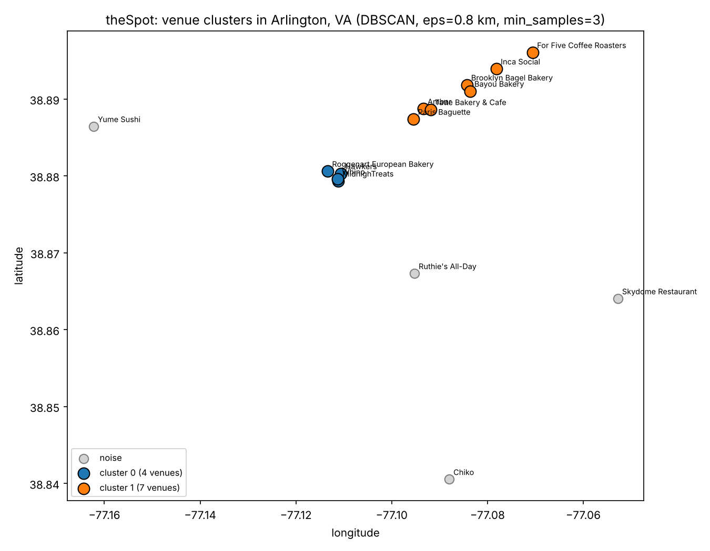

# theSpot: Venue Hotspot Analysis

Data analysis for **theSpot**, a location-based app (in development) that surfaces trending local spots in Arlington, VA. This repo holds the data science side of the project. The app is at [trishas331/theSpot](https://github.com/trishas331/theSpot).

## What's here

| File | Purpose |
|---|---|
| `data/spots.csv` | 15 hand-curated Arlington venues with category, neighborhood, address, coordinates, and the source of each coordinate |
| `hotspot_clustering.ipynb` | DBSCAN (haversine) clustering of venues to find dense hotspots and sparse areas |
| `geocode_venues.py` | Looks up venue coordinates in OpenStreetMap (Overpass API) and flags weak name matches and outliers |
| `clusters.png` | Map of the resulting clusters |

## Data cleaning

Coordinates started as rough estimates. I checked each one against OpenStreetMap and Google Maps and found several problems: one venue was in Arlington, Texas, not Virginia (removed); several chain locations were matched to the wrong branch (DC, Falls Church); one pin landed about 1.2 miles from the real address. The geocoding script now picks the branch nearest the expected location and rejects weak name matches. Every coordinate is labeled with its source in the `coord_source` column.

## Results

At eps = 0.8 km and min_samples = 3, DBSCAN found 2 clusters covering 11 of 15 venues: a Clarendon / Courthouse / Rosslyn group (7 venues) and a Ballston group (4 venues). The cluster count is 2 for eps between 0.3 and 1.2 km, and the groups merge into one at 2.0 km. Four venues (Crystal City, Shirlington, South Arlington, East Falls Church) are labeled noise, which marks where the map would be sparse at launch.



## Limitations

- Small sample (n = 15), manually selected, so the clusters describe the seed list and not Arlington as a whole.
- One location (For Five Coffee, Rosslyn) is confirmed by OpenStreetMap only.
- The "why it's viral" notes come from web research, not verified TikTok data.

## Roadmap

- [x] Verify venue coordinates against OpenStreetMap and Google Maps
- [ ] Expand the dataset to 50+ venues and rerun the clustering
- [ ] Extract venue names from TikTok captions with spaCy NER (planned)
- [ ] Add a recommender once real user behavior exists

## Run it

```bash
pip install -r requirements.txt
jupyter notebook hotspot_clustering.ipynb
```
`geocode_venues.py` needs internet access and relies on free public servers, which are sometimes overloaded; rerun it later if it fails.
